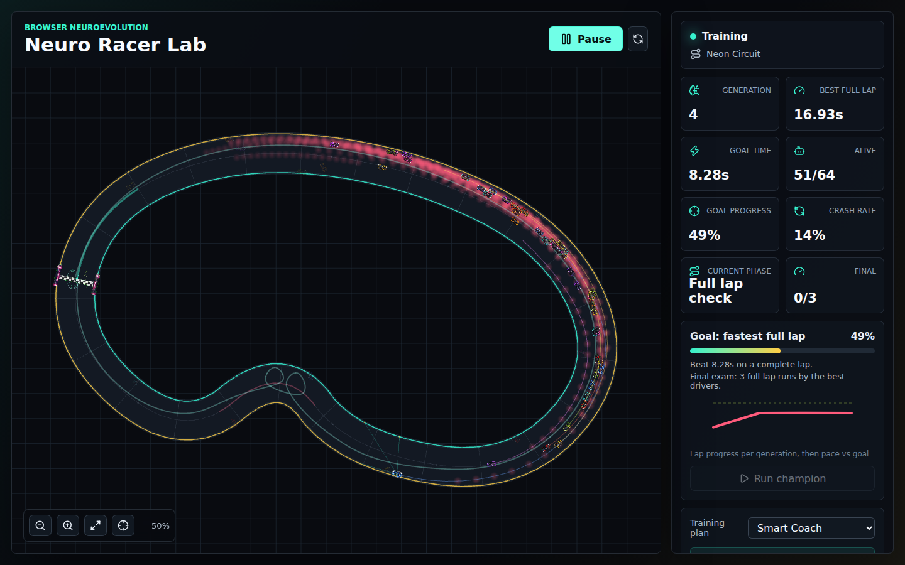
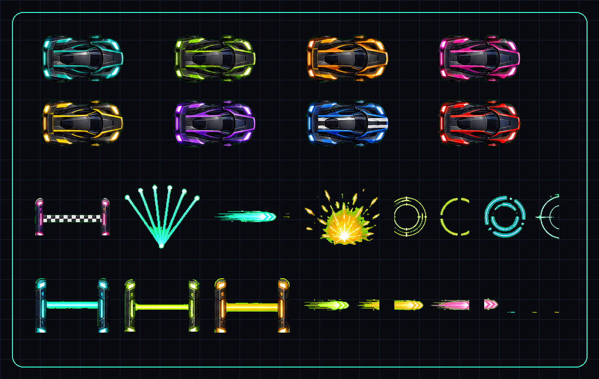

# Neuro Racer Lab

Interactive neuroevolution racing lab for the browser. Draw a custom track, let a population of neural drivers train on it, then run the fastest champion around a full lap.

[](https://github.com/Blizzeq/neuro-racer-lab/actions/workflows/ci.yml)
[](https://neuro-racer-lab.vercel.app)
[](https://www.typescriptlang.org/)
[](https://phaser.io/)
[](LICENSE)

**Live demo:** [neuro-racer-lab.vercel.app](https://neuro-racer-lab.vercel.app)
**Repository:** [github.com/Blizzeq/neuro-racer-lab](https://github.com/Blizzeq/neuro-racer-lab)





## What It Does

Neuro Racer Lab is a public web demo where a population of small neural networks learns to drive a track you draw, as fast as possible.

- Draw a route on an unbounded pan/zoom canvas (mouse, trackpad, or touch with pinch-zoom).
- The app smooths the route and builds road walls, checkpoints, sectors, and a spawn pose. Self-crossing, tiny, or overlapping routes are rejected with a clear message.
- 64 cars drive in parallel with ray sensors and a compact neural controller.
- A Smart Coach curriculum trains difficult sectors, validates full laps, and finishes with a final exam.
- The champion is the genome with the shortest completed full lap, not just the highest partial score.
- Save/load (browser storage) and JSON export/import preserve the track, training config, and best driver.
- Ghosts, heat traces, sector highlights, sensor rays, and live stats make the learning process visible.

## Training Goal

The goal is explicit: train until one driver finishes the whole track close to the ideal lap time.

The goal time is derived from the track itself. A reference driver follows the centerline at the car's grip limit, braking before and accelerating out of every corner. The goal is that reference lap plus 8%. A twisty track gets a slower goal than an oval of the same length, and the cars have to learn to brake to reach it.

Smart Coach runs in phases:

1. **Learning start**: basic steering and forward progress on full laps.
2. **Sector practice**: cars start from several parts of the track, so long routes train faster.
3. **Hard corner practice**: population pressure moves to the sectors with the most crashes.
4. **Full lap validation**: regular checks that sector skills combine into a real lap.
5. **Record attempt**: tries to beat the current best lap.
6. **Final exam**: the population must produce a completed full lap in `finalExamRounds` exam generations.
7. **Training complete**: unlocks a champion run with the best driver.

Training also ends (through the final exam) when the best lap has not improved for `goalPatienceGenerations` generations.

## How Learning Works

Each driver owns a JSON-compatible genome: a flat list of weights for a fixed neural network.

- **Inputs (8):** five wall-distance rays, speed, heading error to the look-ahead tangent, and upcoming turn direction.
- **Network:** 8 → 7 (tanh) → 2 (tanh) MLP; outputs are steering and throttle/brake.
- **Car model:** throttle, air drag, brake drag, partial lateral grip, and a grip-limited yaw rate (`v²/r` capped), so tight corners need a slower entry speed.
- **Fitness before a full lap:** progress along the centerline, sector completion, and speed.
- **Fitness penalties:** crashes, reversing, stagnation, and driving too close to walls.
- **Final ranking:** once a car completes a lap, a shorter lap time always wins.
- **Evolution:** elites are kept, the best historical driver seeds teacher mutations, strong parents cross over, and random immigrants keep exploring.

This is an interactive neuroevolution demo, not a formal reinforcement learning benchmark. The priority is a clear learning loop, strong visual feedback, and a convincing browser experience.

## Architecture

The simulation is plain TypeScript with no rendering or DOM dependencies. The same code runs in the browser, in unit tests, and in a headless Node trainer.

```text
src/
  lib/
    geometry.ts         track generation, validation, boundary loop cleanup
    trackIndex.ts       spatial grid: ray casts, capsule-vs-wall collisions, windowed progress
    simulation.ts       car physics, sensors, progress, stagnation, fitness, reference lap
    trainingSession.ts  generation lifecycle: curriculum, evolution, goal, final exam, stats
    curriculum.ts       Smart Coach sectors and start selection
    evolution.ts        elitism, teacher mutations, crossover, immigrants
    neural.ts           genome, MLP evaluation, mutation, crossover
    storage.ts          save/load and validated JSON import/export
  sim/RacerScene.ts     Phaser renderer + camera and input (pan, wheel, pinch, drawing)
  components/           React simulator shell
  App.tsx               UI, metrics, controls
scripts/                headless trainer and browser QA scripts
public/assets/          generated car sprites and effect assets
```

Implementation notes:

- **Viewport-sized WebGL canvas.** The canvas matches the stage size (× device pixel ratio, capped at 2), and pan/zoom is a Phaser camera. The world is unbounded, so tracks can be drawn anywhere.
- **Deterministic fixed-step simulation.** Each tick is 1/60 s. Speed settings run 1–64 ticks per frame, capped by a per-frame time budget so the UI stays responsive.
- **Fast sensing.** Wall segments live in a uniform grid. Rays use grid traversal (DDA), and collisions test the car capsule only against nearby walls. Car speed stays below the capsule diameter, so cars cannot tunnel through walls.
- **Continuous progress.** Progress along the centerline is tracked with a windowed nearest-segment search. On hairpins a car cannot "jump" to a spatially closer but later part of the track.
- **Robust tracks.** Corners tighter than half the road width create reversed loops in the inner wall. Those loops are collapsed, so there are no invisible walls inside the road.
- **Safe imports.** Imported JSON is validated: genome size and finite weights, clamped config, and track geometry rebuilt from the centerline. A broken file cannot crash the simulator.

## Tech Stack

- Vite 8
- React 19
- TypeScript 6
- Phaser 3.90 (WebGL with Canvas fallback)
- Vitest
- tsx (headless trainer)
- Vercel static hosting

## Local Development

Requires Node.js 22.12 or newer.

```bash
npm install
npm run dev
```

Open the Vite URL shown in the terminal.

## Scripts

| Command | Description |
| --- | --- |
| `npm run dev` | Start the local Vite dev server. |
| `npm test` | Run unit tests with Vitest. |
| `npm run build` | Type-check and build the static production site. |
| `npm run preview` | Preview the production build locally. |
| `npm run train:headless` | Train in Node (no browser) on benchmark tracks and report learning speed. |
| `npm run observe:training` | Launch Chrome, start training, and log Smart Coach metrics through the debug hook. |
| `npm run smoke:ui` | Browser smoke test: zoom/fit, drawing, save/load, export/import, starting training. |
| `npm run check:canvas` | Reload the app several times and check that the canvas renders (not blank/white). |

## Headless Training

`TrainingSession` does not depend on the renderer, so the full training loop can run in Node at thousands of ticks per second:

```bash
npm run train:headless -- --generations=40 --seeds=3 --tracks=preset,oval,kidney,technical --mode=smartCoach
```

It prints, per track and seed, the generation of the first completed lap, the best lap, the goal time, and the pace relative to the goal. Runs are deterministic for a given seed, so it is the fastest way to check whether a change to physics, fitness, or evolution helps or hurts. Add `--verbose` to log every generation.

## Browser QA

Run the dev server (or `npm run preview`) in one terminal and the scripts in another. The scripts use `playwright-core` with an installed Chrome/Chromium. Set `CHROME_PATH` if it is not in a standard location.

```bash
npm run dev
node scripts/observe-training.mjs --seconds=60 --mode=smartCoach --speed=16 --seed=qa-01
npm run smoke:ui
npm run check:canvas
```

The observer seeds `Math.random`, clicks Start, and records phase, generation, alive cars, crash rate, best lap, goal progress, record attempts, and sector coverage. Add `--track=easyLoop` to draw a simple oval first, or `--url=http://127.0.0.1:4173` to test the preview build. Run observers one at a time, because parallel WebGL sessions can distort results.

## Controls

- **Drag** to pan, **mouse wheel / trackpad pinch** to zoom at the cursor, **two-finger pinch** on touch screens.
- **Draw track**: draw one closed loop in a single stroke. Right- or middle-drag still pans while drawing.
- **Follow best car**: the camera tracks the current leader and shows its sensor rays.
- **Reset** (circular arrows): start training from scratch on the current track.
- **Run champion**: replay the best driver alone on a full lap (available once a champion exists).

## Visual Assets

The visual pack was generated for this project and stored as transparent, game-ready assets:

- `public/assets/cars/*.png`: 8 transparent top-down car sprites used by the racers.
- `public/assets/effects/*.png`: checkpoint gates, sensor fans, boost streaks, sparks, and rings.
- `public/assets/manifest.json`: stable paths for reusing the generated assets elsewhere.
- `docs/neuro-racer-game-assets.png`: preview sheet for the asset pack.
- `public/og-image.png`: OpenGraph preview built from the asset pack.

## Deployment

The app is fully static. The Vercel project is connected to this GitHub repository: every push creates a preview deployment, and `main` deploys to production.

Manual deploy with the Vercel CLI:

```bash
npm run build
npx vercel deploy --prod
```

Production: [https://neuro-racer-lab.vercel.app](https://neuro-racer-lab.vercel.app)

## GitHub About

Recommended repository metadata:

- **Description:** Interactive neuroevolution racing lab: draw a track, train neural cars, and run the fastest champion in the browser.
- **Website:** `https://neuro-racer-lab.vercel.app`
- **Topics:** `machine-learning`, `neuroevolution`, `genetic-algorithm`, `racing-game`, `phaser`, `react`, `typescript`, `vite`, `vercel`, `simulation`, `ai-demo`

## License

[MIT](LICENSE)
